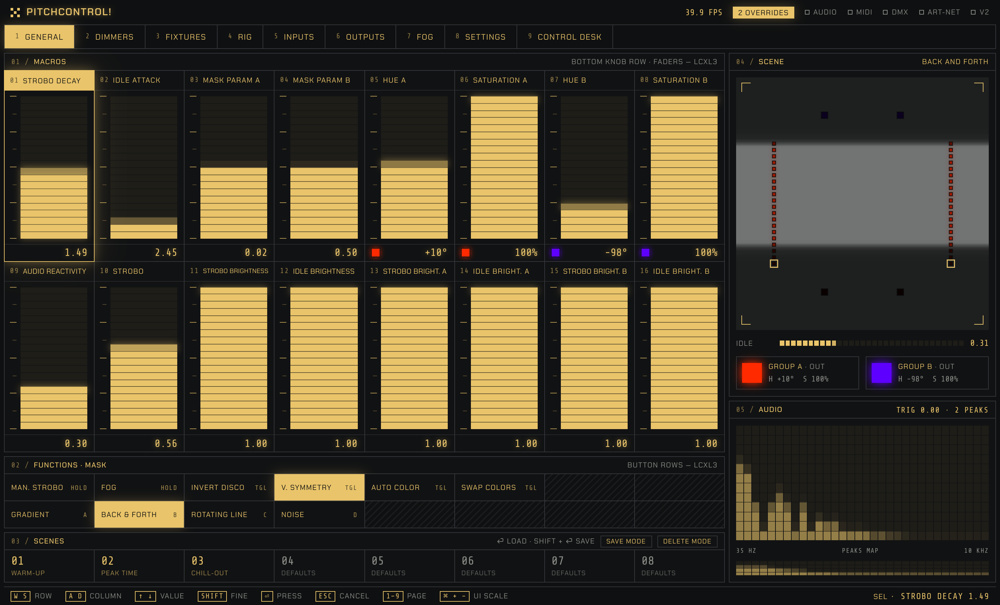
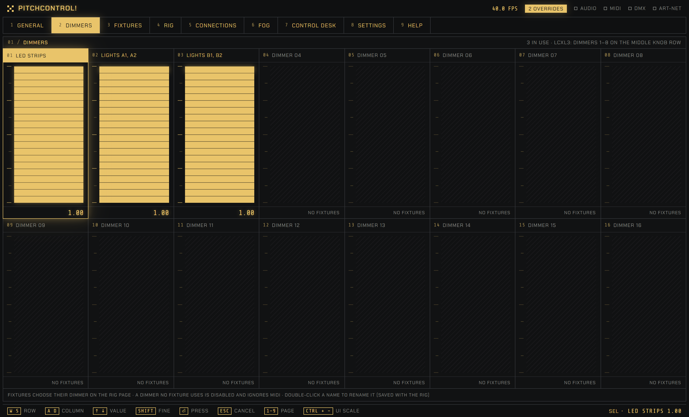
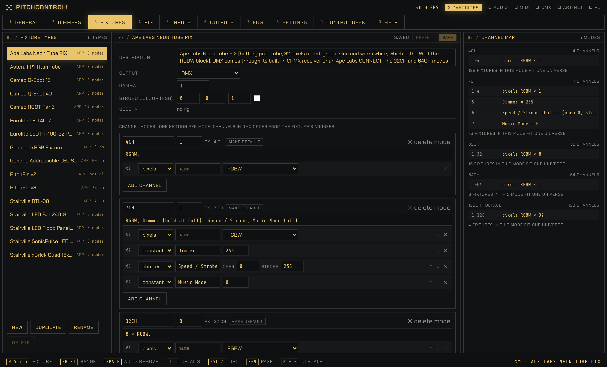
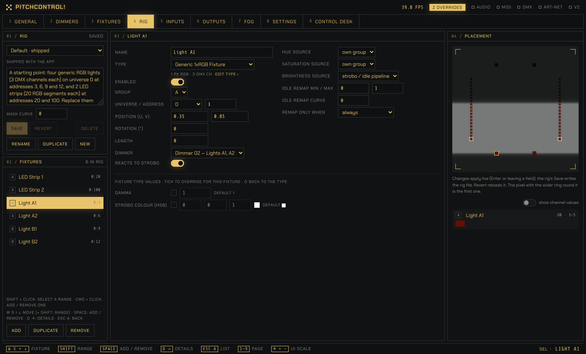
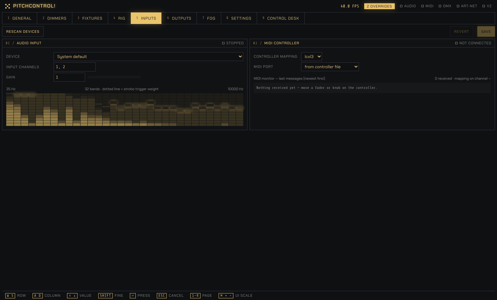
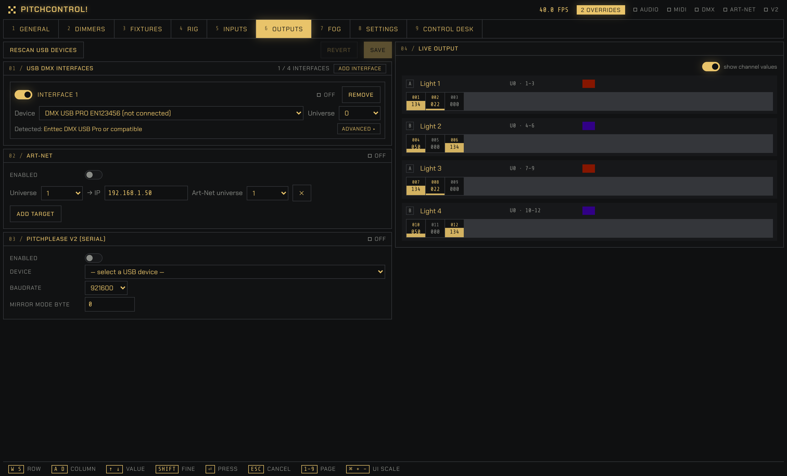
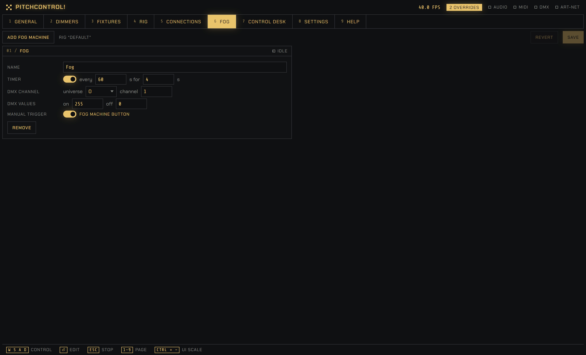
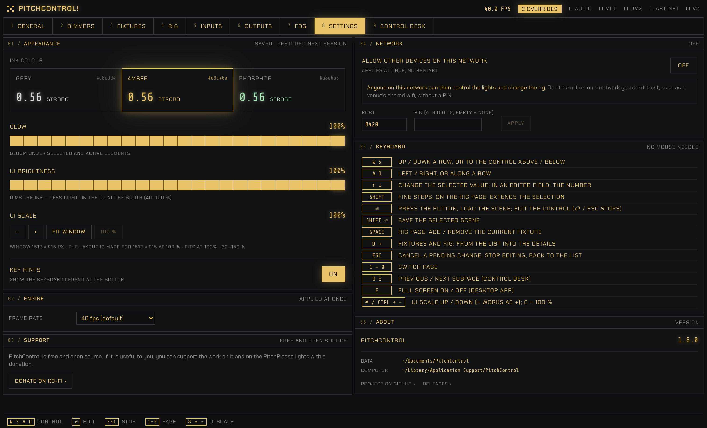
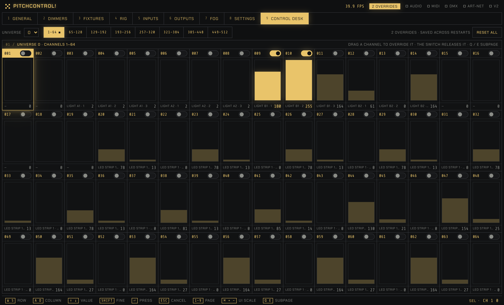
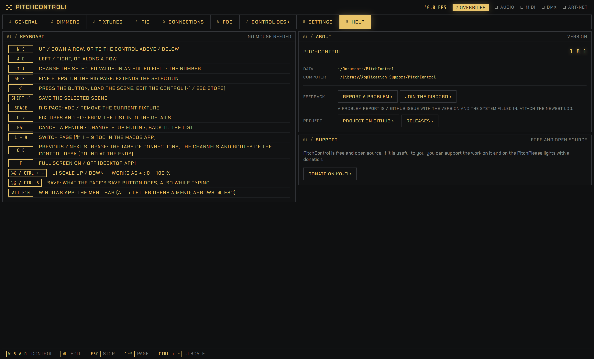

# PitchControl

Audio-reactive light control for DMX and Art-Net: kicks trigger the strobo, moving masks drift across your rig. A cross-platform (macOS / Windows) port of a vvvv gamma patch; it also drives PitchPlease LED strips.

Website, documentation and downloads: **[pitchcontrol.eu](https://pitchcontrol.eu)**.

Community: **[Discord](https://discord.gg/4nbBaQDKz4)** for questions and chat, [GitHub issues](https://github.com/hlavamir/PitchControl/issues) for bugs (Help → About → Report a problem fills one in), [Discussions → Ideas](https://github.com/hlavamir/PitchControl/discussions/categories/ideas) for feature ideas.

- **Backend** (`backend/`, Python): the engine, which runs at 40 FPS in its own thread and owns audio, MIDI and all outputs. It keeps running if the browser is closed.
- **Frontend** (`frontend/`, Vite + React + TypeScript + Tailwind): the pages General, Dimmers, Fixtures, Rig, Inputs, Outputs, Fog, Settings and Control Desk. It talks to the backend over HTTP and a WebSocket.
- **Config** (`config/`): the read-only defaults that ship with the app (fixture types, the MIDI mapping, the Default rig, settings). What you make or change is kept in your data folder, see [Folders](#folders).

## Pages

Keys 1–9 and 0 switch between the pages. Everything can be operated from the keyboard (see [Using the UI](#using-the-ui)). The footer at the bottom of every page shows the keys for the control under the mouse and a short explanation of it; the screenshots show it without a hovered control. On a first start the macros begin with their defaults: a calm test pattern for setting up the DMX output (Strobo and Audio Reactivity at 0, so the music changes nothing until you raise them).

### 1 · General



The page for playing the show:
- **Macros:** 16 faders for strobo decay, idle attack, the two mask parameters, the two group colours (hue / saturation), audio reactivity and the strobo / idle brightness of each group. They map to the Launch Control XL's bottom knob row and faders.
- **Functions and masks:** manual strobo, fog, invert discoball, vertical symmetry, auto colour, swap colours, and the four masks A–D: Gradient, Back & Forth, Rotating Line and Noise.
- **Scenes:** the 8 scenes. ⏎ loads one, Shift + ⏎ (or save mode) stores the current macros into it, delete mode empties a slot. An empty slot loads the default values; no scenes ship with the app.
- **Scene:** a live preview of the mask with every fixture pixel in the colour it is sending. Below it, the phase bar: strobo drains it after each peak, idle fills it back. Then the final colours of groups A and B.
- **Audio:** the 32 frequency bands with the peaks map that triggers the strobo.

### 2 · Dimmers



16 dimmer faders, one per group of lights; the Launch Control XL's page knob switches its faders between General and Dimmers. Each fixture picks its dimmer on the Rig page. A dimmer that no fixture uses is disabled (hatched, "no fixtures") and ignores MIDI. Double-click a name to rename it; Enter confirms, Esc cancels. The names are saved with the rig.

### 3 · Fixtures



The fixture types: everything shared by all fixtures of one model, one JSON file each in `config/fixtures/types/`.
- **Fixture types:** the list, with New, Duplicate, Rename and Delete. Renaming updates every rig that uses the type; a type that a rig uses can't be deleted.
- **Import OFL…** (also File → Import Fixture → Open Fixture Library…): turns a fixture of the [Open Fixture Library](https://open-fixture-library.org) into a type, from a downloaded `.json` file or online by manufacturer and fixture. A report shows what was taken, what was left out and why, and the assumptions, before anything is saved; see [Importing from the Open Fixture Library](#importing-from-the-open-fixture-library). Desktop only: a device on the network can't import (the button is off there).
- **Import QLC+…** (also File → Import Fixture → QLC+…): turns a [QLC+](https://qlcplus.org) fixture definition (`.qxf`) into a type, from a file or from the QLC+ folders on this computer; the heads of a pixel bar become pixels, 16 bit and switching channels are read as in the Open Fixture Library, and what can't be used is reported and kept; see [Importing from QLC+](#importing-from-qlc). Desktop only.
- **Links and source:** a type that came from the Open Fixture Library shows its manual, product page and video links and where it came from, under the type's settings.
- **Fixture library:** ten ready-made types come with the app (listed under [Fixture library](#fixture-library)); like every shipped type they can be edited (your copy goes to your data folder) and reset to default.
- **Type editor:** description, output (DMX or the PitchPlease v2 serial protocol), gamma and the strobo colour (HSB). Below that are the **channel modes**, one section per mode (at least one): a name (as the fixture's display or manual calls it, e.g. 6CH), the **pixel count of that mode** (a bar can have 1 pixel in one mode and 8 in another; the PitchPlease v2 serial type keeps one Pixels field above), a short description and the channel layout in DMX order. Each channel is a constant (e.g. master = 255), a macro (e.g. a strip dimmer following "Dimmer 01"), a shutter (open / strobe values) or the pixel block (I, RGB or RGBW; **I** is one brightness channel per pixel, the brightest of its R, G and B, for a single-colour light such as a white or UV spot or a dimmer channel). ↑ ↓ ✕ reorder and remove channels.
- **Modes:** **Add mode** appends a copy of the last mode (a new mode is mostly the old one with a channel more or less); **make default** marks the mode a new rig fixture starts in; **✕ delete mode** removes one (not the last). A mode that fixtures of the active rig run in asks first and names them; they move to the default mode (the rig then has unsaved changes). Two modes with the same name get a warning.
- **Channel map:** the resulting DMX channels of every mode with their numbers, the total, and how many fixtures of the type fit one universe.

Edits apply to the lights right away and mark the type unsaved; Save writes the file, Revert reloads it.

### 4 · Rig



The rig: the fixtures of one event and everything that differs per fixture.
- **Rig:** load, save, revert, rename, duplicate, create or delete rig files, and edit the description. Unsaved changes are flagged, and loading another rig asks first.
- **Fixtures:** the list of fixtures with Add / Duplicate / Remove. Shift + click selects a range, ⌘ / Ctrl + click adds or removes one, to edit them together.
- **Fixture editor:** name, type (with a summary and an "edit type" link), the channel mode (a dropdown, only for a type with more than one mode: it must be the mode set on the fixture itself, because it decides how many channels the fixture takes; a new fixture starts in the type's default mode; scenes don't store it), group, DMX universe (a dropdown of 0–3) and address, placement (position, rotation, length), dimmer, whether it reacts to strobo, colour sources and idle remap. Number fields step with ↑ / ↓ or a right-mouse drag.
- **Fixture type values:** gamma, the strobo colour and the named constant channels can be overridden per fixture. The checkbox switches an override on. Switched off, the field is greyed out but keeps its value, so switching it on again restores it; "default" shows the type's value, and ↺ goes back to it.
- **Placement:** the selected fixtures highlighted in the scene preview, their live output colours and, with "show channel values", a table of the DMX channels they write.

### 5 · Inputs



- **Audio input:** device, input channels and gain, with the 32-band meter. The dotted line shows how strongly each band counts towards the strobo trigger.
- **MIDI controller:** controller mapping and port, and a monitor of the last received messages, showing which macro each one moved or why it was ignored.
- **MIDI mapping:** one row per macro with its control (CC or note, channel), Learn, behaviour (fader, encoder, toggle, held, press), page and shift (one shift button); saved as your own copy of the controller file.
- **Art-Net / DMX input:** DMX that comes in from another program or a console, for the routes of the Control Desk. **Art-Net** listens on UDP port 6454 (the standard; change it when another Art-Net program on this computer has the port without sharing it) on all network adapters or on the one you pick; PitchControl's own Art-Net output is ignored. **DMX over USB** takes an Enttec DMX USB Pro that receives (the Pro only; a Pro that receives can't send, so the same device can't also be an output, and the output wins). A list shows each Art-Net universe that has sent something (the raw Art-Net port address, counted from 0), its sender, packets per second and when it was last seen. The values of an input are kept when the sender goes quiet. Per computer (`machine.json`, key `live_input`); the switches apply at once, only on the computer that runs PitchControl. `py tools/live_input_sim.py artnet` sends test Art-Net.

### 6 · Outputs



Up to four USB DMX interfaces (Add interface / Remove; each with its own device and universe; the type is detected, see [USB DMX interfaces](#usb-dmx-interfaces)), Art-Net targets (the app's universe 0–3 → IP, with the Art-Net universe 0–15 on the wire), the PitchPlease V2 serial output (device, baud rate, mirror mode) and [OSC](#osc-output) (the base colours A and B to one IP address and port). Live output on the right shows what every fixture sends: pixel colours and, with "show channel values", the channel table.

#### OSC output
Section 04 of the Outputs page sends the **base colours A and B** over OSC (UDP) to one IP address and port, for example to a video mapping program: the colours as the Hue / Saturation faders or Auto Color Change make them (Swap Colors applied), before strobo, brightness, masks, dimmers and gamma. Switch it on with **Enabled**, give the **IP address** (a broadcast address works) and **Port**, and choose a file under **Messages**. The status dot says *sending*, *no file*, *nothing to send*, *file problem* or *not sending* (with the reason in the footer).

What is sent is described by a JSON file in the `osc/` folder of your data folder (next to `controllers/`; the app ships three examples that are always listed). A file is an array of entries with three keys:

```json
[
  {"what": "color_a.rgba", "address": "/color_a", "format": "r"},
  {"what": "color_b.g",    "address": "/color_b/green", "format": "i"}
]
```

- `what`: `color_a` or `color_b`, plus `.r`, `.g`, `.b` or `.rgba`;
- `address`: the OSC address (starts with `/`);
- `format`: `.r`, `.g` and `.b` are one value, `f` (float 0–1) or `i` (integer 0–255); `.rgba` is one OSC colour, `r` (four bytes R, G, B and A = 255).

Everything else is ignored (and counted in the section: "2 ignored: …"). A message goes out when its value changes, and everything again once a second, so a receiver started later catches up. A file you edit while the app runs is read again within a second; one that can't be read keeps the last good messages going and shows the error. OSC is sent from its own thread: a wrong address or a dead receiver never slows the lights. Saving only OSC changes restarts only OSC, not the DMX outputs.

#### USB DMX interfaces

Pick the device and its universe; the app finds out how to talk to it from the USB device ("Detected: …" under it). Two kinds are supported:

| Detected as | Devices | How it works |
|---|---|---|
| **Enttec DMX USB Pro or compatible** | Enttec DMX USB Pro and Pro Mk2 (one universe), DMXKing ultraDMX Micro / Pro and other interfaces that speak the Enttec Pro protocol | The interface has a processor: the app sends one packet per frame over the serial port and the interface makes the DMX signal. Tried on hardware (Enttec DMX USB Pro). Also what the app assumes when it cannot tell. |
| **Enttec Open DMX USB (bare FTDI)** | Enttec Open DMX USB (the cheaper one in the blue case) and other bare FTDI + RS-485 dongles | No processor: the app makes the DMX signal itself on the serial port (250 kbaud, 8N2, break, start code 0, 512 channels), about 26 frames per second. Tried on hardware on macOS; the lines RTS and DTR have to be low, which the app does. |

**Advanced** (under each interface, closed by default; a dot means something is set by hand): the interface type, if the detection is wrong or the interface is unusual, and for the bare FTDI type how the break is made. "One byte at a lower baud rate" is the default and the only one that works with the macOS driver; "the port's break line" can leave the dongle in a break that only unplugging clears. `tools/open_dmx_probe.py` tries the ways of driving such a dongle one by one, for a new computer or interface.

Not supported: interfaces that only work through their manufacturer's driver or software (Nicolaudie / Sunlite, ChamSys, Anyma uDMX and similar), and sACN. Art-Net covers every network node with an Art-Net input (DMXKing eDMX, Enttec ODE, …).

### 7 · Fog



The fog machines of the active rig, one panel each: a timer ("every 60 s for 4 s"), DMX universe and channel, on / off values, and whether the Fog button on the General page (or the controller) fires it by hand. The header shows when it is fogging. Fog machines are part of the rig: loading another rig switches them, and Save writes them into the rig file (only them; other unsaved rig changes stay unsaved). A fog channel that a fixture uses too is reported. The Default rig has one, on channel 1.

### 8 · Settings



- **Appearance:** ink colour (grey, amber, phosphor), glow, UI brightness for a dark booth, UI scale (with "Fit window" for small screens) and the key-hint footer. All of it is saved and restored next session.
- **Network:** lets a phone or an iPad on the same network open the UI in its browser (see [Other devices on the network](#other-devices-on-the-network)).
- **Engine:** the frame rate.
- **App** (desktop app only): open the UI in a browser, open the data folder, open the logs folder, start in full screen.
- **Log:** the log of this run, read-only, as the log file has it: time, level, logger, message (a traceback under its line). **Errors are red, warnings amber, info in the normal text colour, debug dim.** The view follows the newest line: **Auto-scroll** is on by default, switch it off to stay where you are; scrolling up by hand pauses it (the switch shows that) and scrolling back to the end resumes. **Copy** puts the lines on the clipboard as text, for a bug report. The view keeps the last 2,000 lines of the run (the backend keeps the last 3,000 records: `logsetup.MemoryLogHandler`; `GET /api/log` gives them, new ones follow over the live websocket in batches while the panel is open). **Help → Show log** in the menu bar opens Settings at this panel. The panel is on this computer only: a phone or tablet on the network gets no panel and no stream (`/api/log` answers 403), because the log carries paths and device names. The log *file* (one per start, Settings → App → Open logs folder) is unchanged.

The keyboard reference, About and Support are on the Help page (0).

### 9 · Control Desk



Every DMX output channel as a slider: pick a universe (0–3) and a subpage of 64 channels (Q / E step through them). The faint bar is what the channel sends now, and the footer names the fixture using it. Dragging a channel, or switching it on, overrides it with the slider value; the switch releases it. Overrides survive restarts. While any are active, the header shows "N overrides", and "Reset all" releases them all after a confirmation.

**Routes** (below the grid) copy live input onto output channels: a block of an Art-Net universe (or of the DMX input; both are set up on the Inputs page) goes to output channels, from one channel up to a whole universe. A route is its source (Art-Net with its raw port address, or the DMX input), the first input channel, the count (1–512), the output universe and the first output channel; each can be switched on and off and named. **Three layers, the later one wins:** the app's own output (fixtures, fog), then the routes, then the manual overrides: a channel you override keeps your value, the route stays underneath and shows again when you release the override. **An input that stops keeps its last values** on the routed channels; a route lets go when it is switched off or removed. A new route starts off. Routed channels are drawn in blue (apart from the overrides in the ink) and the header counts them ("N overrides · M routed"); when two routes write the same output channel, the one lower in the list wins and the page names the overlap. Routes are saved across restarts (`state/routes.json`); the values of the input are not, so after a restart the fixtures show until the first packet arrives. The API: `GET`/`PUT /api/routes`, `POST /api/routes`, `PATCH`/`DELETE /api/routes/{id}`.

**MIDI routes** (Add MIDI route) take each output channel from a MIDI control instead of from a block of input channels. A MIDI route has a MIDI device (any input port, the controller of the MIDI mapping included) and a MIDI channel (1–16), and **each of its channels has its own input**: a **CC** (0–127 scaled to 0–255), a **14-bit CC pair** (the number and the number + 32), a **note** (its velocity while it is held, or on / off = 255 while held; 0 after) or a **constant** value. A channel with no input writes nothing, and a CC or note that hasn't been touched yet writes nothing either, so the fixtures show until the control moves; after that the last value stays. **Learn per channel:** each channel has a Learn button; click it, move a knob or press a key on the device, and its CC or note is taken for that channel (no stepping through the channels; Learn ends by itself after 20 s, and a control heard on another MIDI channel is reported). A MIDI route has up to 64 channels. **Overlap notice:** when a control of a route is also in the app's MIDI mapping (same device and MIDI channel), the page says so ("CC 21 on <device> also drives Strobo Decay in the MIDI mapping: both will react"): a warning, not a block. The controller's own port is shared (a MIDI port can't be opened twice on Windows): its messages go to the routes too. Same three layers and hold-last-value as the other routes. API: `PATCH /api/routes/{id}/channels/{n}`, `POST /api/routes/{id}/learn`.

### 0 · Help



- **Keyboard:** the complete keyboard reference (the menu bar's Help → Keyboard shortcuts opens it).
- **About:** the version (with the number of commits since the last release and whether the source was modified), links to the project and its releases, and **Report a problem**: it opens a new issue on GitHub in the browser with the version, the system (the computer's operating system and its version) and where the UI was opened from already filled in, under the headings What happened, What you expected and Steps. You see and edit everything before you send it; PitchControl itself sends nothing. Please attach the newest log file: Settings → App → Open logs folder, the newest file is the current run. On a phone or tablet on the network it is a plain link that opens on that device. Feature ideas go to [Discussions → Ideas](https://github.com/hlavamir/PitchControl/discussions/categories/ideas), where they can be voted on. **Join the Discord** next to it opens the [PitchControl Discord](https://discord.gg/4nbBaQDKz4) for questions and chat.
- **Support:** PitchControl is free; the Ko-fi link takes donations.

## Download

Ready-to-run builds for macOS (Apple Silicon) and Windows are on the [Releases page](https://github.com/hlavamir/PitchControl/releases/latest). Download the zip for your system and unpack it; no Python or Node needed. A downloaded app keeps what you make or change in `Documents/PitchControl/` and this computer's settings in the app-data folder; see [Folders](#folders). What changed between versions is in [CHANGELOG.md](CHANGELOG.md); the running version is shown in Help → About.

## Run

**macOS:** double-click `run.command`. On first run it sets up the Python environment and builds the UI (it rebuilds when sources change), then starts the backend and opens the UI in the browser. Close the Terminal window to stop. Extra arguments are passed through, e.g. `./run.command --no-hardware`.

**Windows:** double-click `run.bat` — same behaviour (uses `uv` if installed, otherwise `py -3` / `python`).

Manual setup — requirements: Python ≥ 3.11 with [uv](https://docs.astral.sh/uv/), and Node 20.19 or newer, or 22.12 or newer (only to build the UI; Vite 8 refuses older versions).

```bash
cd backend
uv venv && uv pip install -e ".[dev]"
cd ../frontend && npm install && npm run build
cd ../backend && .venv/bin/python -m pitchcontrol
```

Open http://127.0.0.1:8420.

Options:
- `--no-hardware` runs without audio, MIDI and outputs.
- Other devices (a phone) on the network are allowed in Settings → Network, not on the command line: `--host` is ignored (see [Other devices on the network](#other-devices-on-the-network)).
- `--data <folder>` uses another data folder instead of the repo's `data/` (gitignored); `--machine <folder>` another folder for this computer's files (default: `.machine/` in the data folder); `--port`, `--logs` change the defaults.

On Windows, use `.venv\Scripts\python -m pitchcontrol`. ASIO devices appear in the Inputs page device list.

For frontend development, run `npm run dev` in `frontend/` (port 5173, proxied to the backend on 8420).

Tests: `cd backend && .venv/bin/python -m pytest`; the frontend rules (MIDI mapping overlap and behaviours) have Vitest tests: `cd frontend && npm test`.

## Standalone app

`packaging/` builds a self-contained app (no Python or Node needed on the target machine). It must be built on the target OS:

- **macOS:** double-click `packaging/build_macos.command` (or run it from Terminal; needs Node.js 20.19+ or 22.12+); it produces `dist/PitchControl.app` and `dist/PitchControl-macos-<arch>.zip` (about 46 MB, 22 MB zipped). The Terminal shows everything the steps print, and the same output goes to `build-macos.log` in the repo root (the latest run only, gitignored), which is what to send when a build fails or prints warnings. An Apple Silicon build runs only on Apple Silicon Macs.
- **Windows:** double-click `packaging\build_windows.bat` (needs Node.js 20.19+ or 22.12+, and Python 3.11 or 3.12: `python-rtmidi` has no Windows wheels for newer Pythons, so the script picks 3.12 / 3.11 even when a newer one is installed too); it produces `dist\PitchControl\PitchControl.exe` and a zip. The window shows the steps and stays open at the end; everything the steps print goes to `build-windows.log` (gitignored), which is what to send when a build fails.
- **Both scripts check what is installed before they build:** the UI packages (`npm ci`, recorded in `frontend/node_modules/.installed-with` with the Node version and a hash of `package-lock.json`) and the Python environment (`backend/.venv/.installed-with`: the Python version and a hash of `pyproject.toml`). When one is missing or out of date they say what and why and ask once, `Install now? [Y/n]` (Enter = yes); "n" stops and prints the commands to run by hand. On CI, or without a terminal, they install without asking; `--check` only says what would be installed.
- **Both, on GitHub:** Actions → "PitchControl app" → Run workflow (`.github/workflows/app.yml`), then download the zips from the run.

The app shows the UI in its own window. "Open in browser", "Open data folder" and "Open logs folder" are in Settings → App; Help → About shows the folders. Closing the window stops the engine: it asks first when an output is live or a page has unsaved edits.

**Menu bar.** The app has the usual menus: **File** (Save, Import Fixture ▸ Open Fixture Library… / QLC+…, Open data folder, Open logs folder, Quit), **Edit** (Cut, Copy, Paste, Select All, on the text field you are typing in), **View** (the ten pages, Full screen), **Window** (Minimize, and Zoom on macOS / Maximize on Windows) and **Help** (Documentation, Keyboard shortcuts, Show log, Report a problem, Join the Discord, About PitchControl). **Save** does what the page's Save button does (Inputs, Outputs, Fog, the MIDI mapping, Fixtures, Rig) and nothing on a page without one; ⌘S / Ctrl+S does the same, also while typing in a field. **Quit** asks first like the close button. On **macOS** it is the system's menu bar, with About, Settings… (⌘,) and Quit (⌘Q) under PitchControl, and ⌘1 – ⌘9 for the pages next to the plain 1 – 9 (Help is 0: ⌘0 stays the UI scale's 100 %). On **Windows** the app draws it in its header row next to the logo, in the app's look, with the keys next to the items: **Alt** (or F10) gives it the keyboard, Alt + the underlined letter opens a menu, the arrows move, ⏎ runs an item and Esc closes; AltGr (typing @ { [) doesn't open it. A browser, on this computer or on a phone, shows no menu bar. The first Edit → Paste asks once for permission to read the clipboard (Ctrl+V needs none).

The app uses the folders described in [Folders](#folders); it never writes into its own bundle or into the repo's `config/`.

The builds are unsigned. On first launch:
- macOS: open the app once; when macOS refuses, go to System Settings → Privacy & Security and click "Open Anyway" (right-click → Open no longer bypasses this since macOS 15).
- Windows: SmartScreen → More info → Run anyway.

macOS asks once for microphone access.

App options (for example from a terminal) are the same as for the backend (`--data`, `--machine`, `--port`, `--no-hardware`), plus `--no-window` (use the browser instead of a window).


### Releasing a version

Versions follow semantic versioning (see [CHANGELOG.md](CHANGELOG.md)). The number lives only in `backend/src/pitchcontrol/__init__.py`.
1. Set `__version__`, and move the changelog's "Unreleased" notes under a `## X.Y.Z — date` heading.
2. If a default in `config/` changed since the last release, commit it, then record it: `backend/.venv/bin/python tools/shipped_config_history.py` (it adds every committed version of the shipped files to `config/shipped_history.py`, so a later migration recognises untouched copies) and commit that too.
3. If the UI changed since the last release (`frontend/src`), retake the screenshots from a clean checkout of the release commit, so Help → About shows the plain version: build the frontend, then run `tools/screenshots.py` (see its header for the setup). Check the ten PNGs in `screenshots/`, then commit.
4. Commit, then tag and push: `git tag -a vX.Y.Z -m "PitchControl X.Y.Z"` and `git push origin vX.Y.Z`.
5. The "PitchControl app" workflow checks that the tag matches `__version__`, builds macOS and Windows, and creates a **draft** release with that version's changelog section. Check it on GitHub, then publish it.

Builds between releases show how far past the last tag they are, e.g. `1.1.0+3 (abc1234)`, or `1.4.0-dev (abc1234)` once the number is raised but not tagged yet.

## Using the UI

The UI is monochrome (Settings → Appearance: grey, amber or phosphor ink, glow strength, UI brightness, UI scale, key hints; saved per computer in `machine.json`).

The layout is made for a 1512 × 915 px window (14" MacBook at its default display setting). On smaller screens, down to 1280 × 720, use Settings → Appearance → UI scale → **Fit window**: it picks the largest scale at which every page fits without scrolling (about 70 % on 1280 × 720). Pixel sizes are CSS pixels, which macOS and Windows scale with the display setting. Colour only appears where it carries information: the hue/saturation scales and the output colours.

Everything works without a mouse — on the General, Dimmers and Control Desk pages one control is always selected, on the other pages the keys move a highlight from control to control (see below). The footer lists the keys and mouse actions for the control under the mouse, with the keyboard focus (Tab) or selected with the navigation keys, with a short explanation of what it does. Every control, label, status indicator and panel has one; a control without its own tip shows the one of its row or panel:

| Key | Action |
|---|---|
| W / S | move the selection up / down a row |
| A / D | move the selection left / right |
| ↑ / ↓ | change the selected value (Shift = fine) |
| ⏎ | press the selected button, load the selected scene (Shift + ⏎ = save) |
| Esc | cancel a pending hue / saturation change |
| 1 – 9, 0 | switch page (0 = Help) |
| Q / E | previous / next subpage (Control Desk) |
| F | full screen on / off (desktop app; on a MacBook it also covers the camera-notch strip) |
| ⌘ / Ctrl + + − 0 | UI scale up / down (`=` works as `+`, no Shift needed), 0 = 100 % (⌘ on macOS, Ctrl on Windows) |
| ⌘ / Ctrl + S | Save: what the page's Save button does, also while typing in a field |
| Alt, F10 | Windows app: the menu bar (Alt + letter opens a menu; arrows, ⏎, Esc); on macOS ⌘1 – ⌘9 switch pages too |

Number fields apply on Enter and keep the focus, so you can type the next value right away (Escape reverts).

**Dialogs block the app underneath.** While a dialog is open (Import Fixture, and the "Unsaved changes" question when you leave a page) the page behind it gets nothing: no page keys, no W A S D, no ⌘ / Ctrl + S, no menu-bar keys, no clicks (a click outside does nothing). Tab goes round the dialog's own controls, **Esc** closes it as Cancel (for the unsaved-changes question: Stay), and the focus goes back to the control that had it. All dialogs share one mechanism (`frontend/src/modal.ts`, `components/Modal.tsx`); ⌘ / Ctrl + + − 0 (UI scale) still work, and on macOS the menu bar's page items wait until the dialog is closed.

**The pages from Fixtures to Settings (3 to 8) are navigated control by control** (the footer shows the keys). On Inputs, Outputs, Fog and Settings the first W / S / A / D (or arrow) highlights the first control; after that W / S or ↑ / ↓ move to the control above / below, A / D or ← / → along a row, and A at the left edge or Esc takes the highlight away. The keys only navigate and never change a value: the highlighted control looks like the selected one on the other pages, and **⏎ starts editing it**: a number or text field takes the caret, a dropdown opens, a slider takes the focus, a button is pressed and a switch or checkbox toggles. While you edit, the keys are text and ↑ / ↓ (or ← / → on a slider) change a value as everywhere (Shift = fine); **⏎ or Esc stops editing** and keeps the value (a number field's Esc drops what you typed first), and W A S D navigate again. A click into a field edits it at once. **Fixtures and Rig** have a list first, which works like a file list in Finder or Explorer: W / S or ↑ / ↓ move the selection to the next fixture type or fixture (they stop at the ends; at the first or last one they carry on to the controls above or below the list), D or → goes into the details, and A at the details' left edge, or Esc, comes back to the list. On the Rig page Shift with the movement keys extends the selection as a range from the anchor (the same rule as Shift + click) and Space adds or removes the current fixture without moving; ⏎ does nothing on the list.

On the Rig page, the **Rig** panel manages the rig file: load another rig from the dropdown, edit the description, set the **Mask curve** (one brightness curve of the mask for all fixtures of the rig, -3 to +3, 0 = unchanged; it adds to each fixture's own idle remap curve), Save / Revert, Rename, Duplicate (saves the current state, unsaved edits included, as a new rig and switches to it; the original file keeps what was saved), New (empty rig) and Delete (the active rig; the next one is loaded, the last rig can't be deleted). A rig that comes with the app is marked "shipped"; saving it keeps your copy in your data folder ("modified"), Reset to default deletes that copy, and it can't be deleted. Fixture types work the same way on the Fixtures page. Loading or creating a rig with unsaved changes asks: Save, Discard or Cancel. Edits are live in the engine right away; only Save writes the file. The **Fixtures** panel below it edits the lights in the rig: Add, Duplicate, Remove.

In the fixture list, Shift + click selects every fixture from the one you clicked last (by a plain or ⌘ / Ctrl click) to the one you click now, in the order shown; ⌘ (macOS) or Ctrl (Windows) + click adds or removes a single fixture, and ⌘ / Ctrl + Shift + click adds a range to what is selected. The same with the keys: Shift + W / S extends the selection from the anchor, Space adds or removes the current fixture and makes it the anchor. Several fixtures can be edited at once. A field shows a value only if all selected fixtures share it, otherwise "multiple"; a value you enter applies to all of them.

**Control Desk** (page 8) shows every DMX output channel as a slider: pick the universe (0–3) and one of 8 subpages of 64 channels. The faint bar is what the channel sends now (the footer names the fixture using it). Dragging a channel, or switching it on, overrides it: it then sends the slider value instead of what the fixtures compute; the switch releases it. Overrides are saved (`state/overrides.json` in this computer's folder) and restored on start; while any are active the header shows "N overrides". "Reset all" (with a confirmation) releases every override in every universe.

Hue and saturation apply on mouse release, or once keys / the MIDI knob rest; until then the fader shows the target with a dashed outline.

## Other devices on the network

The UI is a web page, so a phone or an iPad on the same wifi (or cable network) can open it, and play the lights with it. It is **off by default**: PitchControl listens on this computer only until you turn it on, **Settings → Network → Allow other devices on this network**. It applies at once, no restart.

- **While it is on, anyone who can reach this computer on that network can control the lights and change the rig.** At home that is fine; on a venue's shared wifi, set a PIN, or leave it off.
- **Port:** other devices use one fixed port (default 8420, from 1024 to 65535). It never moves by itself: when another program has it, Settings says so and PitchControl keeps trying, so a bookmark or a QR code stays valid. Choose another port there if you need to.
- **Addresses:** every network adapter of this computer is listed as a link (with a Copy button), the wifi first; pick the one on the same network as the phone. The **QR code** beside it opens that address when scanned with the phone's camera. The address of a computer can change when it joins another network or its router hands out a new one.
- **PIN (optional, 4 to 8 digits):** a device that isn't this computer first gets a PIN page, once; then a cookie keeps it signed in for 30 days, until the PIN is changed or PitchControl restarts. The API and the live connection refuse a device without the cookie. After five wrong PINs from one address, that address waits 30 seconds, then longer. **This computer is never asked.** The PIN keeps visitors off the lights; it is not strong security: the traffic is not encrypted, so someone who can listen on the network can read the PIN.
- **What a device can't do:** change the network settings, or open folders, the browser or full screen on this computer; those work from the computer that runs PitchControl only.
- The switch, port and PIN are per computer (`machine.json`, key `network`).
- **On a phone** the UI has a layout of its own: the General page's macros (as sideways sliders, 01–16 as on the computer), the scenes (load, save and delete), the function and mask buttons, and the Dimmers page; two tabs at the bottom switch between them (in landscape, in the top bar). The scene preview and the audio meters are not on the phone, and the rest (Fixtures, Rig, Inputs, Outputs, Fog, Settings, the Control Desk) stays on the computer: **Full UI on this phone**, at the end of each page, shows the whole UI there too (the **Phone layout** button goes back). A phone is a screen whose shorter side is below 600 px; an iPad gets the full UI. Drag a slider sideways anywhere on its row (a swipe up or down scrolls the page); renaming a dimmer and switching the controller's page work from the computer only.

To try it with a phone: turn the switch on, connect the phone to the same wifi as the computer, scan the QR code, and enter the PIN if there is one. If the page doesn't open, the computer's firewall probably blocks the port: allow PitchControl (Windows asks once, "Allow access"; on macOS, System Settings → Network → Firewall).

## Folders

| Folder | Where | What |
|---|---|---|
| Defaults | inside the app (the repo's `config/`) | what ships: fixture types, MIDI mappings, the Default rig, default settings. Read-only. |
| Your data | `~/Documents/PitchControl/`; a source run: the repo's `data/` (gitignored) | only what you made or changed |
| This computer | `~/Library/Application Support/PitchControl` (macOS), `%LOCALAPPDATA%\PitchControl` (Windows); with `--data` or a source run: `.machine/` in the data folder | `machine.json`, `state/`, `logs/` |

Your data folder is chosen in this order: `--data <folder>`; a folder written in `~/Documents/PitchControl/data_folder.txt`; the repo's `data/` for a source run; `~/Documents/PitchControl`. A data folder that is (or contains) the app's own defaults is refused.

A file in your data folder wins over a default of the same name (ignoring case); lists show both. Saving a shipped rig or fixture type writes your copy; Reset to default deletes it. Every saved file records the version that wrote it (`"app_version"`).

| Path | Content |
|---|---|
| `settings.json` | the show's settings that differ from the defaults: frame rate (`fps`), active rig and controller, Auto Color palette, masks, audio analysis |
| `machine.json` (this computer) | what belongs to one computer: audio input (device, channels, gain), MIDI port, outputs (up to 4 USB DMX interfaces, Art-Net targets, v2 serial, OSC), appearance (`ui`), the network switch with its port and PIN (`network`), the live input (`live_input`: the Art-Net port and adapter, the DMX input device) |
| `fixtures/types/*.json` | one file per fixture model (edited on the Fixtures page); missing keys get defaults; ten ready-made models ship, see [Fixture library](#fixture-library); an imported one also carries the original data, see [Importing from the Open Fixture Library](#importing-from-the-open-fixture-library) |
| `rigs/<name>.json` | fixture instances and fog machines (`fog_machines`, edited on the Fog page) for one event (edited on the Rig page): type, group A/B, universe/address, UV placement (rotation in degrees), dimmer, colour sources, overrides of type values as `{"enabled": …, "value": …}`; the dimmer names (`dimmer_names`); the rig's mask curve (`mask_curve`, 0 if missing) |
| `controllers/*.json` | MIDI controller mappings (CC or note → macro), edited on the Inputs page |
| `osc/*.json` | what the OSC output sends (what, address, format; see [OSC output](#osc-output)), edited by hand; the file is chosen on the Outputs page |
| `scenes/scene_N.json` | the 8 scenes (macro name → control value); an empty slot means the macro defaults |
| `state/macros.json` (this computer) | auto-saved macro values, restored on start; without it (first start) the macro defaults |
| `state/overrides.json` (this computer) | Control Desk channel overrides, restored on start |

Unknown keys (typos) are reported in `logs/YYMMDD_hhmmss.log` (one file per start) and never stop the engine. Keys starting with `_` (e.g. `_note`) are annotations and are ignored. A file that can't be read is renamed (`….json.broken-<time>`, never overwritten), the app's own version of it is used where there is one, and the UI shows a notice. A missing active rig falls back to the Default rig, a missing controller mapping to none.

**From 1.3:** on the first start of 1.4 an old `Documents/PitchControl/config/` is moved into this layout once: `state/` and `logs/` go to this computer's folder, `settings.json` is split into the sparse show part and `machine.json`, and files identical to a version the app ever shipped are dropped (the current defaults apply). Your own files stay. A source checkout used the repo's `config/` as its data before; that setup is in git history (`git show v1.3.0:config/rigs/Default.json`) and can be copied into `data/` or `~/Documents/PitchControl/`.

A fixture type holds one or more **channel modes** (the DMX modes a device offers: 3CH, 4CH, 6CH …), each with an `id`, a `name`, a `description`, its pixel count `pixels` and its **profile**, the ordered `channels` list. `default_mode` is the id of the mode a new rig fixture starts in. Gamma and the strobo colour belong to the type and are the same in every mode:

```json
"modes": [
  { "id": "4ch", "name": "4CH", "description": "Red, green, blue, white", "pixels": 1, "channels": [{ "pixels": "RGBW" }] },
  {
    "id": "9ch",
    "name": "9CH",
    "description": "Master, strobe, colours",
    "pixels": 1,
    "channels": [
      { "name": "master", "value": 255 },
      { "name": "dimmer", "macro": "Dimmer 03" },
      { "name": "strobe", "shutter": { "open": 0, "strobo": 200 } },
      { "pixels": "RGBW" }
    ]
  }
],
"default_mode": "4ch"
```

A rig fixture names its mode with `"mode": "<id>"`. The id is what counts, so renaming a mode never breaks a rig; a fixture without `mode` runs in the type's default mode, and an unknown id is listed as a rig problem (the default mode is used meanwhile). Type files from before 1.6 have a bare `channels` list instead of `modes`: it loads as one mode named by its channel count (`4CH`) and is written back in the new shape when the type is next saved. A type file from before 1.6.1 has one `pixels` for the whole type: it becomes the pixel count of every mode (a mode's own `pixels` wins) and is written into the modes when the type is next saved. An older app reads a type file written by 1.6 as one RGB pixel block, and one written by 1.6.1 as a one-pixel type, so keep a copy of your fixture types before going back.

`value` is a constant (a rig can override it by name with `channel_values`). `macro` sends a macro's value as 0–255. `shutter` sends `strobo` on a peak frame when the instance has `real_strobo` enabled. `pixels` expands to pixel count × `I` / `RGB` / `RGBW`. `I` is one brightness value per pixel, the brightest of its R, G and B after gamma; it was called `R` up to 1.6, and a type file with `R` loads as `I` and is written as `I` when the type is next saved.

To re-import scenes and `macros.ini` from the original vvvv patch folder: `.venv/bin/python -m pitchcontrol.legacy --vl <folder>` (into the repo's `data/`; `--data` chooses another folder).

### Fixture library

Besides the generic types and the Cameo Q-Spot 15 and Eurolite 4C-7, ten popular fixtures ship ready to use, each with **all** the DMX modes PitchControl can drive (the pixel count, the strobe values and the held constants are set per mode), so borrowed gear can be put into a rig without typing channel layouts:

| Type | Modes |
|---|---|
| Stairville LED Flood Panel 150 | 3CH, 4CH, 8CH; default 4CH |
| Stairville LED Bar 240-8 (also the Varytec Giga Bar Pix 8 RGB / Frost) | 2CH, 3CH, 5CH, 24CH; default 24CH |
| Stairville xBrick Quad 16x8W RGBW | 4CH, 6CH, 8CH, 16CH, 18CH; default 18CH |
| Stairville SonicPulse LED Bar 10 (the Bar 05 shares its 4, 5, 6, 11CH modes) | 4CH, 5CH, 6CH, 11CH, 39CH; default 39CH |
| Eurolite LED PT-100-32 Pixel DMX Tube | 3CH, 5CH, 8CH, 48CH, 96CH; default 96CH |
| Ape Labs Neon Tube PIX | 4CH, 7CH, 32CH, 64CH, 128CH; default 128CH |
| Astera FP1 Titan Tube | the profile tables 1, 4, 5, 18, 19, 42, 43 (named by table number), default table 42 (16 pixels RGB) |
| Cameo ROOT Par 6 | 2CH, 4CH1, 4CH2, 5CH, 6CH, 8CH, 11CH, D3CH, D5CH1, D5CH2, D6CH, D7CH, D9CH, D12CH; default 8CH |
| Cameo Q-Spot 40 | 02CH, 03CH1, 03CH2, 04CH, 09CH (as the display prints them, like the Q-Spot 15); default 04CH |
| Stairville BTL-30 | 7CH; default 7CH |

Most were generated from the [Open Fixture Library](https://open-fixture-library.org) (OFL, MIT licence, pinned to one commit; its copyright notice is `config/fixtures/Open Fixture Library notice.txt`) and every one was checked against the manufacturer's manual. The Eurolite PT-100/32, the Ape Labs Neon Tube PIX and the Stairville BTL-30 are not in OFL and were built from their manuals with the same conversion. How a mode is read: R, G, B (W) channels become the pixel block (per pixel for a pixel bar; a warm white is the W); a strobe or shutter channel becomes a shutter with its real open and fastest strobe values (not always 0 and 255: the ROOT Par 6 and Q-Spot 40 multifunction strobes are open again above 250); the master dimmer is held at 255 when the mode mixes colours itself and is an `I` channel when it has no colour channels; amber, UV, programs, speed, sound, delay and mode-select channels are named constants at their "off" or colour-mixing value, and a colour preset that is a mode's only colour source is held at White. A mode PitchControl can't express (a dimmer, amber or strobe per pixel, pixels interleaved with other channels, effect and hue tables) is left out; the Titan Tube ships only the seven profile tables people use (1, 4, 5, 18, 19, 42, 43; the others are listed in the type's `_note`).

To add fixtures or move to a newer OFL commit, edit the list and `OFL_COMMIT` in `tools/fixture_library.py` and run it (`backend/.venv/bin/python tools/fixture_library.py`): it converts the OFL files (kept in `tools/fixture_sources/ofl/` at the pinned commit; `--refresh` downloads them again) with the app's own import (`pitchcontrol.ofl`, the one behind File → Import Fixture), applies the corrections that come from the manuals and writes the type files. Read its report: OFL is community-written, so each new type must be checked against its manual before it ships.

### Importing from the Open Fixture Library

**File → Import Fixture → Open Fixture Library…** (or **Import…** on the Fixtures page) converts one fixture of the [Open Fixture Library](https://open-fixture-library.org) (OFL, MIT licence) into a fixture type, with the same conversion the shipped library was made with (how a mode is read: see [Fixture library](#fixture-library)). It needs the computer that runs PitchControl: a device on the network can't import.

- **From a file:** a fixture's `.json` (on the fixture's page in the library: Download as → Open Fixture Library JSON, or the file from OFL's GitHub). Works offline.
- **Online:** the manufacturer and the fixture from the library on GitHub, or the address of a fixture's page. Everything is read at one commit (shown in the dialog and kept in the type); it needs the internet, so not at a gig. GitHub limits unauthenticated requests: if it says so, wait a while or use a file.
- **The report**, before anything is saved: the modes taken (with pixels and channel count), the modes left out and why (a dimmer or amber per pixel, effect tables, …), the assumptions (e.g. "no open range, open = 0"), the manual's links and the reminder to check the type against the manual: OFL's fixtures are written by volunteers. Then the type's name (a file name; OFL's manufacturer and fixture name are suggested) and **Import**.
- **A name that is taken** (in any letter case, a shipped type too) is named in the dialog with what would be overwritten (and the rigs that use it); you rename the import or **Replace** the type. A shipped type that is replaced gets your own copy (Reset brings the original back). Rigs keep using the name; a fixture whose mode is gone runs in the new default mode.

**What a type keeps of the original.** Imports keep as much of the original data as possible, even what PitchControl doesn't use, so that the fixture can be used again later (exports, updates, other programs). PitchControl's own format stays as it is; what it adds stays close to OFL's: where a key means what an OFL key means it has OFL's name and shape. In the type file:

| Key | What |
|---|---|
| `shortName`, `categories`, `meta`, `comment`, `links`, `helpWanted`, `rdm`, `physical`, `matrix`, `wheels`, `availableChannels`, `templateChannels` (and any other key of the fixture) | OFL's own top-level keys, under their OFL names, untouched. `links` (manual, product page, video) is shown on the Fixtures page |
| `ofl_modes` | OFL's own `modes` list, untouched (OFL's name collides with PitchControl's `modes`) |
| `modes[].ofl_mode` | the name of the OFL mode this PitchControl mode was converted from; modes that could not be converted are in `ofl_modes` only |
| `source` | `format` (`"ofl"`), `fixture` (OFL's key, `manufacturer/fixture`), `name` (OFL's own name), `manufacturer`, `url`, `schema` (OFL's `$schema`), `license` (`"MIT"`), `converter` (the version of this mapping), `key_order` (OFL's top-level keys in their order), and where this copy came from: `commit` (online), `file` (from a file), `schema_version` |

The original OFL fixture can be rebuilt exactly from the type file (`rebuild_ofl` in `backend/src/pitchcontrol/ofl/importer.py`, whose docstring is the complete description of the shape; a test does it for every shipped fixture). The kept keys survive loading, editing on the Fixtures page and saving: they are carried through, whatever you change. Edit PitchControl's own keys (modes, gamma, description), not the kept ones.

### Importing from QLC+

**File → Import Fixture → QLC+…** (or **Import QLC+…** on the Fixtures page) converts a fixture definition of [QLC+](https://qlcplus.org) (a `.qxf` file; QLC+ has thousands of them) into a fixture type. It is read the way the Open Fixture Library's own QLC+ import does it, into OFL's fixture model, and then goes through the same conversion, report and kept data as an OFL import, so there is one mapping to PitchControl. It needs the computer that runs PitchControl: a device on the network can't import.

- **From a file:** any `.qxf` (QLC+'s `Fixtures` folder, the QLC+ forum, a download). Works offline.
- **From QLC+ on this computer:** when QLC+ is installed, the dialog lists the fixtures of its folders (the installation's `Fixtures` folder and your own, e.g. `C:\QLC+\Fixtures` and `C:\Users\<you>\QLC+\Fixtures` on Windows, `/Applications/QLC+.app/Contents/Resources/Fixtures` and `~/Library/Application Support/QLC+/Fixtures` on macOS, `/usr/share/qlcplus/fixtures` and `~/.qlcplus/fixtures` on Linux; the QLC+ 5 and Program Files variants too) by manufacturer and fixture. Without QLC+ the dialog says so and you can still pick a file.
- **How the file is read:** channel presets (`IntensityRed`, `PositionPan`, …) and capability presets (`StrobeSlowToFast`, `ColorMacro`, …) become OFL capabilities, other channels are guessed from their group; **fine channels** (16 bit) become the coarse channel's fine aliases, **`<Alias>` switching channels** become OFL's switching channels (read with the controlling channel at its default, as for OFL fixtures); wheels, physical data, authors and the modes are mapped as OFL does it. **`<Head>` elements become pixels**, which OFL's own importer only warns about: a mode whose heads all have the same channels becomes an OFL matrix with template channels (`Red $pixelKey`, the head number is taken from the channel names, the pixel layout from the `Layout` of the physical data) and a matrix insert, so the mode has as many pixels as it has heads. A channel that several heads list is a plain channel (a master dimmer), heads that list the same channels are one pixel (OFL's pixel groups). A mode whose heads can't be pixels (different channels, not one block of the mode's channels, channels ordered per colour) is left out and the report says why; a mode without heads that lists several RGB sets is warned about (PitchControl takes the first as the pixel and holds the others at their default).
- **The report** is the OFL import's, plus what the OFL model can't hold of the file (an element or attribute nothing read: a focus type, a resource, …).

**What the type keeps:** the same shape as an OFL import (OFL's keys under their names, `ofl_modes`, `modes[].ofl_mode`, `source` with `format: "ofl"`, `via: "qlcplus"` and `file`, the QLC+ file's name; no `fixture`, no `license`: it is your own file) and a key `qlcplus`: `creator` (QLC+'s name, version and the author of the file), `type` (QLC+'s own type), `unmapped` (every element and attribute the reader did not use, with its path) and `xml` (the file itself). The OFL fixture the reader built can be rebuilt exactly from the type (`rebuild_ofl`), and the `.qxf` text is in the type, so nothing of QLC+'s data is lost. QLC+'s fixture files are not shipped with PitchControl (the licence of the individual files is not stated); the test definitions in `backend/tests/qlcplus/` were written for the tests.

## Status

Working and covered by tests:
- config loading and typo reporting; the layered folders (defaults, your data, this computer), copy on save and reset, sparse settings, the 1.3 migration, broken-file handling;
- the v3 DMX frame (checked against the v3.2 firmware layout);
- Enttec Pro, Enttec Open DMX USB, Art-Net and v2.2 serial packet formats;
- the 32-band analysis with octave-weighted strobo trigger;
- the phase, strobo/idle and colour logic;
- the mask generators and noise port, crossfade and symmetry;
- scenes, the REST API and the WebSocket.

The UI runs against the engine at 40 FPS in no-hardware mode.

Verified on macOS: audio input and analysis (microphone test), the LCXL3 MIDI controller, and DMX output through the Enttec DMX USB Pro to one Cameo pinspot (2026-10-07). On a Windows laptop the app builds and starts (2026-10-09). **Not yet verified on hardware:** Art-Net and v2 serial output, several Enttec interfaces at once, and the Windows build with hardware connected. Fixture details and the LCXL3 mapping were confirmed by Miro on 2026-10-05.

The masks match the vvvv look so far, except that Back and Forth rotates in 45° steps (vvvv: 90°); left as is for now.

## License

MIT, see [LICENSE](LICENSE).
