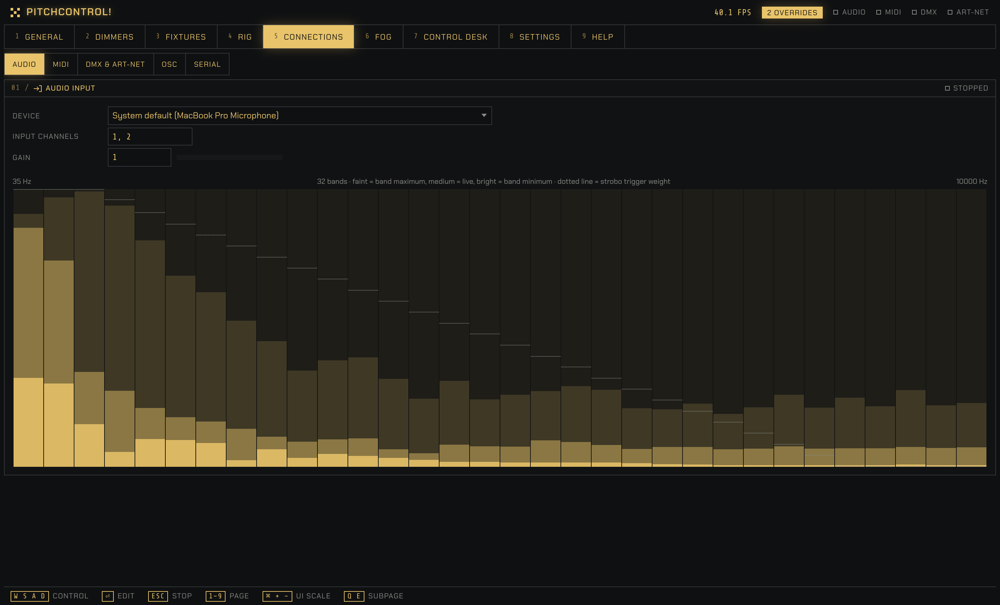
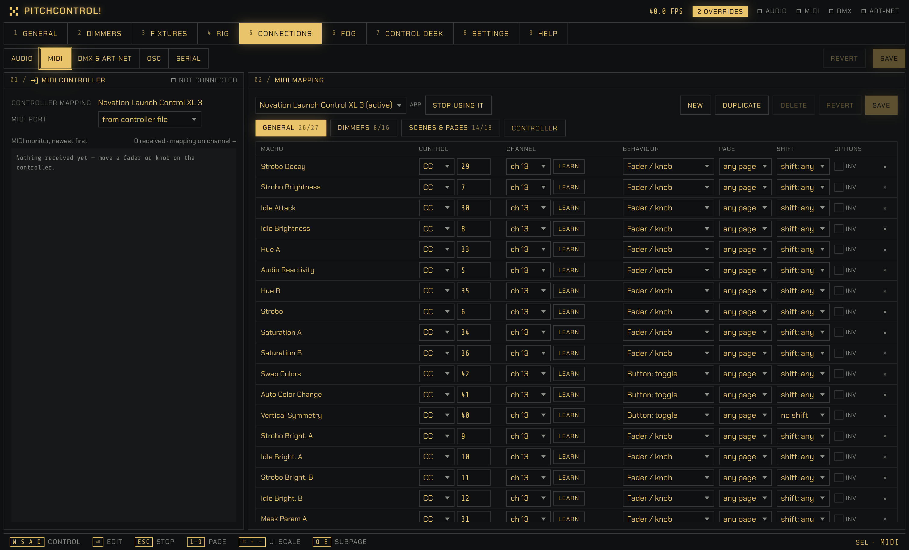
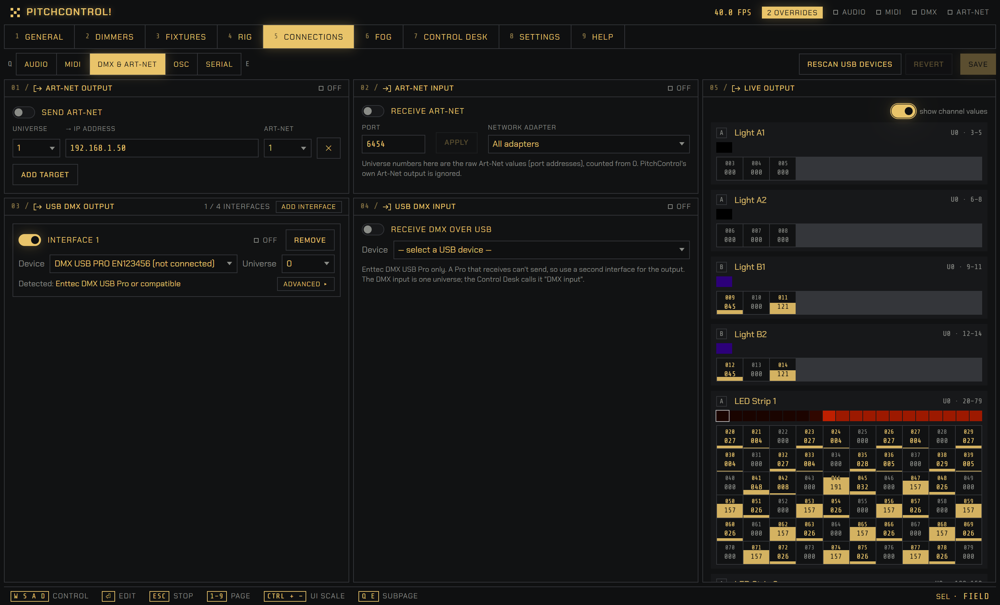
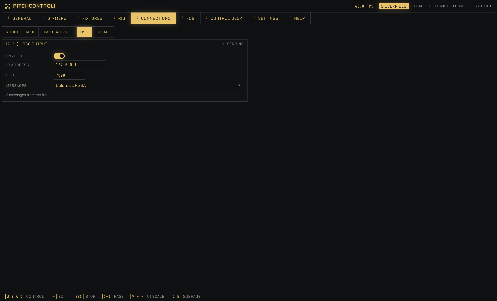
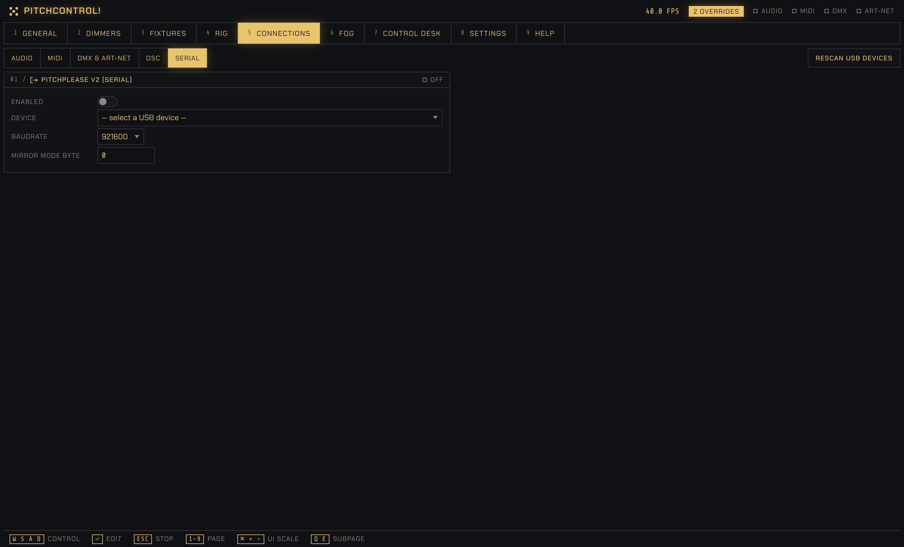

# PitchControl

PitchControl is a free app that makes your DMX lights react to music: it listens, flashes the strobo on the beat and moves colour across your lights, with no cues to program.

## What it does

You play music. PitchControl listens and plays your lights.

- **Music in, lights move.** The app splits the sound into 32 frequency bands and watches them for peaks. The kick and the bass count the most. You don't program cues; you play a set, and the lights follow it.
- **Strobo on the peaks, colour in between.** Every peak fires the strobo. Between the peaks, the lights fade back to their idle colours. You choose two colours, one for each of two groups of lights, and how fast everything fades.
- **Masks move the light across your lights.** A mask is a moving pattern of brightness: a gradient, a band sliding back and forth, a turning line or a drifting cloud. Each light sits at a place in the room, and the mask sets its brightness for where it sits. That makes the light travel across your rig instead of every light doing the same thing.
- **Scenes.** When you like a look, save it into one of eight scenes and bring it back with a click or a key.
- **Free and open source.** PitchControl is free to use, MIT licensed and has no account and no subscription. It runs on macOS and Windows. There is no installer: you unpack it and start it.

## Why it's easy

- **Download and start.** There is nothing to install, and it works without an internet connection.
- **It comes with a starting rig and fixture types**, so you can see something move before you have set anything up.
- **A calm test pattern on the first start.** Strobo and Audio Reactivity begin at 0, so the music changes nothing until you raise them. That makes it easy to check that every light answers.
- **Everything works from the keyboard.** The footer at the bottom of every page shows the keys for the control under the mouse, with a short explanation of it.
- **Your phone is a remote.** A phone on the same wifi can play the lights.
- **Your lights are easy to add.** The app has a library of common fixtures, and you can import more from the [Open Fixture Library](https://open-fixture-library.org).

## What you need

- **A computer:** a Mac with Apple Silicon, or a PC with 64-bit Windows.
- **Lights that take DMX**, and a way to send DMX to them: a USB DMX interface (a cheap Open DMX-style dongle, or an Enttec DMX USB Pro type) or an Art-Net node on your network. The Pro type is the safer choice for a show: an Open DMX dongle works too, but when the computer is busy, the lights can go dark for a moment now and then.
- **Sound.** The built-in microphone of your computer works. An audio interface with a line signal from a mixer is better.
- **Optional:** a MIDI controller, and a phone or a tablet. You can do everything without them.

## Get started

1. **Download** the zip for your system from [pitchcontrol.eu](https://pitchcontrol.eu) or the [GitHub releases](https://github.com/hlavamir/PitchControl/releases/latest), and unpack it.
2. **Start it.** The app isn't signed, so the first time your system asks you to confirm it: on a Mac, open System Settings → Privacy & Security and click **Open Anyway**; on Windows, click **More info**, then **Run anyway**. A Mac also asks once for the microphone, because that is how PitchControl hears the music.
3. **Choose the audio input and the DMX output.** Press <kbd>5</kbd> for **Connections**. On the **Audio** tab, pick your input and play some music: the meter should move. On the **DMX & Art-Net** tab, add your USB DMX interface or the IP address of your Art-Net node.
4. **Put your lights in the rig.** Press <kbd>4</kbd> for the **Rig** page. Add each light, choose its type, and set its DMX address, its group (A or B) and its place in the room, then save.
5. **Play.** Press <kbd>1</kbd> to go back to **General**. Start some music, raise **Audio Reactivity** and **Strobo**, and try the four masks.

There is a longer walk-through, with every step explained, in [Getting started](https://pitchcontrol.eu/docs/getting-started) on the website.

## The pages

PitchControl has nine pages. The keys <kbd>1</kbd> to <kbd>9</kbd> switch between them, and <kbd>Q</kbd> and <kbd>E</kbd> step through the tabs inside a page.

### 1 · General

This is where you play (the screenshot at the top). The faders set how fast the strobo fades, how strongly the music shapes the light, the two colours and the brightness. Buttons switch the masks and the functions, such as a manual strobo, and the eight scenes sit below them. A live preview shows every light in the colour it is sending, and the audio panel shows the 32 bands moving.

More: [docs/general.md](docs/general.md)

### 2 · Dimmers

A dimmer is a brightness fader for a group of lights. Put the wash lights on one and the LED strips on another, and you can turn the strips down without touching the rest. You choose each light's dimmer on the Rig page; there are 16, and you can rename them.

More: [docs/dimmers.md](docs/dimmers.md)

### 3 · Fixtures

A fixture type describes one model of light: how many DMX channels it uses and what each channel does. Ready-made types of common lights come with the app, and you can import more from the Open Fixture Library or QLC+, or write your own. You come here when your light is not in the list.

More: [docs/fixtures.md](docs/fixtures.md)

### 4 · Rig

A rig is the list of lights for one event. For each light you set its type, its DMX address, its group (A or B) and its place in the room, and the place decides what the masks do to it. Save one rig for each venue and load it when you arrive.

More: [docs/rig.md](docs/rig.md)

### 5 · Connections

Everything that goes in and out of the app, one tab for each topic.

**Audio:** choose the sound input and watch the 32-band meter move with the music.

**MIDI:** see your MIDI controllers and what they send, and link a control to a function with Learn; ready-made mappings for two controllers come with the app, as examples.

**DMX & Art-Net:** pick your USB DMX interface or enter the address of an Art-Net node, and see what every light is sending.

**OSC:** send the two group colours to other software, for example a video mapping program.

**Serial:** drive PitchPlease LED strips over a USB serial connection.

More: [docs/connections.md](docs/connections.md)

### 6 · Fog

If you have a fog machine on a DMX channel, it gets a panel here with a timer, for example 4 seconds every 60. You can also fire it by hand with the Fog button on the General page. Fog machines are part of the rig.

More: [docs/fog.md](docs/fog.md)

### 7 · Control Desk

The Control Desk shows every DMX channel as a slider. Drag one to set that channel by hand, for example for a house light or a light that misbehaves. The value stays until you release it, also after a restart.

The last tab, **Routes**, lets something else take over some of the channels: a lighting console, another program or a MIDI controller. The rest of your lights keep following the music.

More: [docs/control-desk.md](docs/control-desk.md)

### 8 · Settings

Here you set the ink colour and the size of the interface, the frame rate and whether a phone or a tablet may connect. The log of the current run is here too, which helps when something goes wrong.

More: [docs/settings.md](docs/settings.md)

### 9 · Help

Help has the full list of keys, the version of the app and a button that checks whether there is a newer one. If something goes wrong, **Report a problem** opens a prefilled report on GitHub in your browser, and you can edit it before you send it.

More: [docs/help.md](docs/help.md)

## Control it from your phone

A phone or a tablet on the same wifi can open PitchControl in its browser and play the lights. Turn it on under Settings → Network, then scan the QR code with the phone's camera. A phone gets a layout of its own, with the faders, the scenes, the function and mask buttons and the dimmers; a tablet gets the full interface. While it is on, anyone on that network can control your lights, so on a shared wifi set a PIN, or leave it off.

 

More: [docs/network.md](docs/network.md)

## Learn more

- The website has the guides: [pitchcontrol.eu/docs](https://pitchcontrol.eu/docs).
- The details of every page, the keys, the folders and files, and the fixture library are in [docs/](docs/README.md).
- What changed between versions is in [CHANGELOG.md](CHANGELOG.md).

## Community

**[Discord](https://discord.gg/4nbBaQDKz4)** for questions and chat, [GitHub issues](https://github.com/hlavamir/PitchControl/issues) for bugs (Help → About → Report a problem fills one in), [Discussions → Ideas](https://github.com/hlavamir/PitchControl/discussions/categories/ideas) for feature ideas.

## For developers

The engine is written in Python and the interface in React. How to run it from source, build the standalone app and release a version is in [docs/development.md](docs/development.md).

## License

MIT, see [LICENSE](LICENSE).
