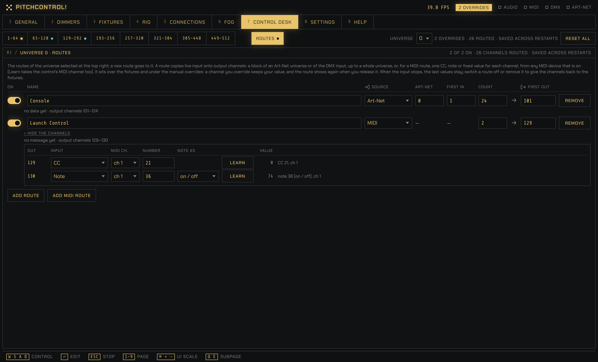

# Control Desk

Every DMX output channel as a slider, with manual overrides, and the routes from other sources.

[← All documentation pages](README.md)

Every DMX output channel as a slider: pick a subpage of 64 channels in the tab row, and a universe (0–3) with the Universe selector at the right of that row; the last subpage is **Routes**, set apart from the channel subpages by a gap (Q / E step through all nine and wrap around, so Q from 1–64 goes to Routes). The faders take the full height of the page. The faint bar is what the channel sends now, and the footer names the fixture using it. Dragging a channel, or switching it on, overrides it with the slider value; the switch releases it. Overrides survive restarts. While any are active, the header shows "N overrides", and "Reset all" releases them all after a confirmation.

**Routes** (the last subpage; the Universe selector, the override and routed counts and Reset all stay in the row above) are **per universe**: the page lists the routes whose output is the universe chosen with the Universe selector, a new route goes to that universe (there is no output-universe field; the route still stores it), and a line counts the routes of the other universes ("3 more routes on other universes (1, 2)"). They copy live input onto output channels: a block of an Art-Net universe (or of the DMX input; both are set up in Connections → DMX & Art-Net) goes to output channels, from one channel up to a whole universe. A route is its source (Art-Net with its raw port address, or the DMX input), the first input channel, the count (1–512) and the first output channel; each can be switched on and off and named. **Three layers, the later one wins:** the app's own output (fixtures, fog), then the routes, then the manual overrides: a channel you override keeps your value, the route stays underneath and shows again when you release the override. **An input that stops keeps its last values** on the routed channels; a route lets go when it is switched off or removed. A new route starts off. Routed channels are drawn in blue (apart from the overrides in the ink) and the header counts them ("N overrides · M routed"); when two routes write the same output channel, the one lower in the list wins and the page names the overlap. Routes are saved across restarts (`state/routes.json`); the values of the input are not, so after a restart the fixtures show until the first packet arrives. The API: `GET`/`PUT /api/routes`, `POST /api/routes`, `PATCH`/`DELETE /api/routes/{id}`.

**MIDI routes** (Add MIDI route) take each output channel from a MIDI control instead of from a block of input channels. A MIDI route listens to every MIDI device that is on (item 91), and **each of its channels has its own input** with its own MIDI channel (1–16): a **CC** (0–127 scaled to 0–255), a **14-bit CC pair** (the number and the number + 32), a **note** (its velocity while it is held, or on / off = 255 while held; 0 after) or a **constant** value. A channel with no input writes nothing, and a CC or note that hasn't been touched yet writes nothing either, so the fixtures show until the control moves; after that the last value stays. **Learn per channel:** each channel has a Learn button; click it, move a knob or press a key on any device that is on, and its MIDI channel and CC or note are taken for that channel (no stepping through the channels; Learn ends by itself after 20 s, and a control heard on another MIDI channel is reported). A MIDI route has up to 64 channels. **Overlap notice:** when a control of a route is also in the app's MIDI mapping (same device and MIDI channel), the page says so ("CC 21 on <device> also drives Strobo Decay in the MIDI mapping: both will react"): a warning, not a block. The controller's own port is shared (a MIDI port can't be opened twice on Windows): its messages go to the routes too. Same three layers and hold-last-value as the other routes. API: `PATCH /api/routes/{id}/channels/{n}`, `POST /api/routes/{id}/learn`.
