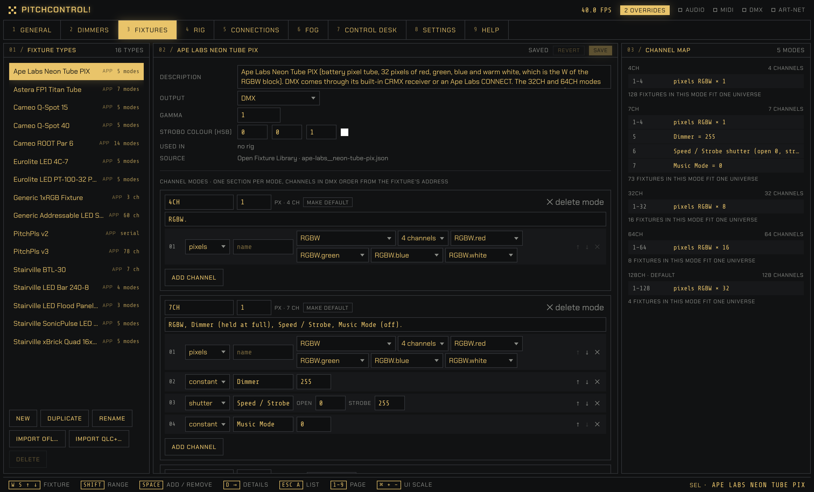

# Fixtures

The fixture types: the editor for one model's channels, its modes and the imports.

[← All documentation pages](README.md)

The fixture types: everything shared by all fixtures of one model, one JSON file each in `config/fixtures/types/`.
- **Fixture types:** the list, with New, Duplicate, Rename and Delete. Renaming updates every rig that uses the type; a type that a rig uses can't be deleted.
- **Import OFL…** (also File → Import Fixture → Open Fixture Library…): turns a fixture of the [Open Fixture Library](https://open-fixture-library.org) into a type, from a downloaded `.json` file or online by manufacturer and fixture. A report shows what was taken, what was left out and why, and the assumptions, before anything is saved; see [Importing from the Open Fixture Library](fixture-library.md#importing-from-the-open-fixture-library). Desktop only: a device on the network can't import (the button is off there).
- **Import QLC+…** (also File → Import Fixture → QLC+…): turns a [QLC+](https://qlcplus.org) fixture definition (`.qxf`) into a type, from a file or from the QLC+ folders on this computer; the heads of a pixel bar become pixels, 16 bit and switching channels are read as in the Open Fixture Library, and what can't be used is reported and kept; see [Importing from QLC+](fixture-library.md#importing-from-qlc). Desktop only.
- **Links and source:** a type that came from the Open Fixture Library shows its manual, product page and video links and where it came from, under the type's settings.
- **Fixture library:** ten ready-made types come with the app (listed under [Fixture library](fixture-library.md#fixture-library)); like every shipped type they can be edited (your copy goes to your data folder) and reset to default.
- **Type editor:** description, output (DMX or the PitchPlease v2 serial protocol), gamma and the strobo colour (HSB). Below that are the **channel modes**, one section per mode (at least one): a name (as the fixture's display or manual calls it, e.g. 6CH), the **pixel count of that mode** (a bar can have 1 pixel in one mode and 8 in another; the PitchPlease v2 serial type keeps one Pixels field above), a short description and the channel layout in DMX order. Each channel is a constant (e.g. master = 255), a macro (e.g. a strip dimmer following "Dimmer 01"), a shutter (open / strobe values) or the pixel block. ↑ ↓ ✕ reorder and remove channels.
- **Pixel block, the order of the colours:** a pixel takes **1, 3 or 4 channels** and every channel has a dropdown for what goes into it: **RGB.red / green / blue** (the colour as it is), **RGBW.red / green / blue / white** (the colour with the white taken out of it, and the white) or **HSB.hue / saturation / brightness** (the colour as hue, saturation and brightness). The preset menu fills them in for the usual cases: **I** (one channel, HSB.brightness: the brightest of R, G and B, for a single-colour light such as a white or UV spot or a dimmer channel), **RGB**, **GRB** (WS2812-type strips) and **RGBW**; changing one channel makes a custom order (a friend's strips that want GBR or BGR), and the channel count menu sets the channels to the defaults of 1 (HSB.brightness), 3 (RGB) or 4 (RGBW). The gamma of the type applies to light (the RGB and RGBW channels and HSB.brightness), not to HSB.hue and HSB.saturation. Imports from the Open Fixture Library and QLC+ keep the order of the colour channels of the original. The Channel map lists the order, and the Output monitor (Rig and Connections, with *show channel values*) marks each channel of a pixel with its colour and names it in its tip. The PitchPlease v2 serial type keeps its own RGB.
- **Modes:** **Add mode** appends a copy of the last mode (a new mode is mostly the old one with a channel more or less); **make default** marks the mode a new rig fixture starts in; **✕ delete mode** removes one (not the last). A mode that fixtures of the active rig run in asks first and names them; they move to the default mode (the rig then has unsaved changes). Two modes with the same name get a warning.
- **Channel map:** the resulting DMX channels of every mode with their numbers, the total, and how many fixtures of the type fit one universe.

Edits apply to the lights right away and mark the type unsaved; Save writes the file, Revert reloads it.
