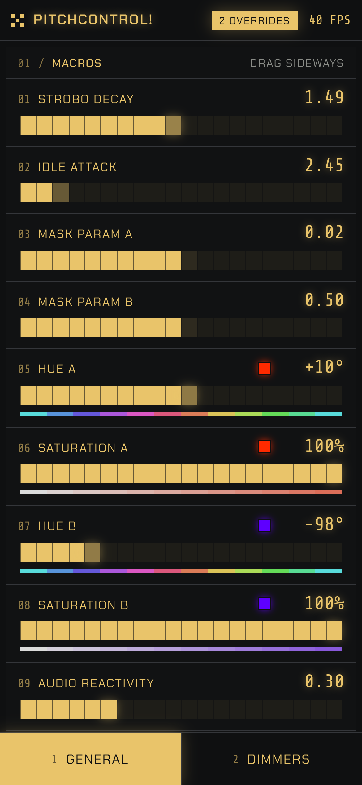
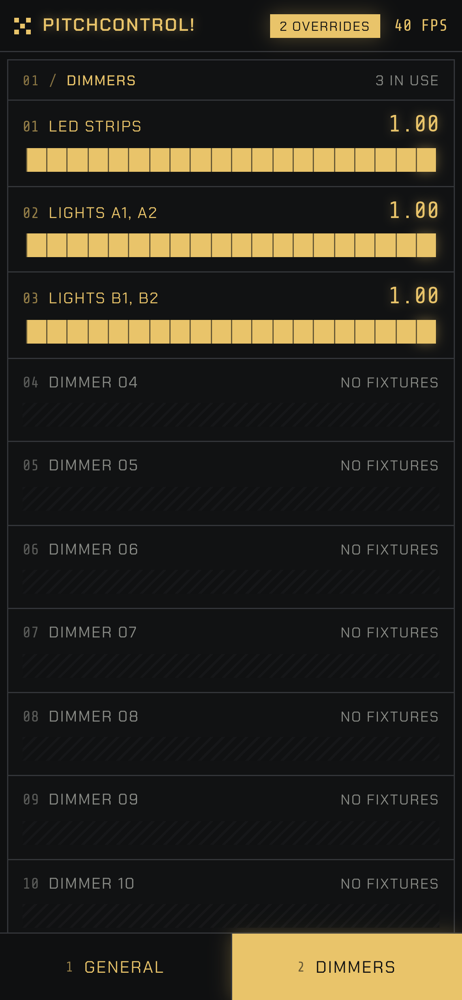

# Other devices on the network

Opening the UI on a phone or an iPad: the switch, the port, the PIN and the phone layout.

[← All documentation pages](README.md)

The UI is a web page, so a phone or an iPad on the same wifi (or cable network) can open it, and play the lights with it. It is **off by default**: PitchControl listens on this computer only until you turn it on, **Settings → Network → Allow other devices on this network**. It applies at once, no restart.

- **While it is on, anyone who can reach this computer on that network can control the lights and change the rig.** At home that is fine; on a venue's shared wifi, set a PIN, or leave it off.
- **Port:** other devices use one fixed port (default 8420, from 1024 to 65535). It never moves by itself: when another program has it, Settings says so and PitchControl keeps trying, so a bookmark or a QR code stays valid. Choose another port there if you need to.
- **Addresses:** every network adapter of this computer is listed as a link (with a Copy button), the wifi first; pick the one on the same network as the phone. The **QR code** beside it opens that address when scanned with the phone's camera; it is drawn in the app's ink (amber by default, whatever ink is chosen) on the dark ground, light modules on dark, with the standard four-module border. The camera apps of current iPhones and Android phones read it; some older or third-party scanner apps can't read inverted codes. The address of a computer can change when it joins another network or its router hands out a new one.
- **PIN (optional, 4 to 8 digits):** a device that isn't this computer first gets a PIN page, once; then a cookie keeps it signed in for 30 days, until the PIN is changed or PitchControl restarts. The API and the live connection refuse a device without the cookie. After five wrong PINs from one address, that address waits 30 seconds, then longer. **This computer is never asked.** The PIN keeps visitors off the lights; it is not strong security: the traffic is not encrypted, so someone who can listen on the network can read the PIN.
- **What a device can't do:** change the network settings, or open folders, the browser or full screen on this computer; those work from the computer that runs PitchControl only.
- The switch, port and PIN are per computer (`machine.json`, key `network`).
- **On a phone** the UI has a layout of its own: the General page's macros (as sideways sliders, 01–16 as on the computer), the scenes (load, save and delete), the function and mask buttons, and the Dimmers page; two tabs at the bottom switch between them (in landscape, in the top bar). The scene preview and the audio meters are not on the phone, and the rest (Fixtures, Rig, Connections, Fog, the Control Desk, Settings) stays on the computer: **Full UI on this phone**, at the end of each page, shows the whole UI there too (the **Phone layout** button goes back). A phone is a screen whose shorter side is below 600 px; an iPad gets the full UI. Drag a slider sideways anywhere on its row (a swipe up or down scrolls the page); renaming a dimmer and switching the controller's page work from the computer only.

 

To try it with a phone: turn the switch on, connect the phone to the same wifi as the computer, scan the QR code, and enter the PIN if there is one. If the page doesn't open, the computer's firewall probably blocks the port: allow PitchControl (Windows asks once, "Allow access"; on macOS, System Settings → Network → Firewall).
