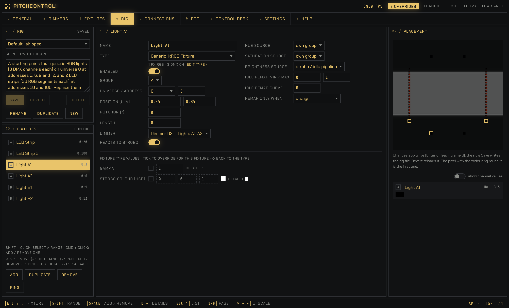

# Rig

The fixtures of one event and everything that differs per fixture.

[← All documentation pages](README.md)

The rig: the fixtures of one event and everything that differs per fixture.
- **Rig:** load, save, revert, rename, duplicate, create or delete rig files, and edit the description. Unsaved changes are flagged, and loading another rig asks first.
- **Fixtures:** the list of fixtures with Add / Duplicate / Remove / Ping. Shift + click selects a range, ⌘ / Ctrl + click adds or removes one, to edit them together.
- **Ping** (key <kbd>P</kbd>): with one fixture selected, it flashes white at full three times in one second, to see which light it is while you set up. The flash is on top of everything the rig sends: the app's own output, the routes (Control Desk → Routes) and the manual overrides (Control Desk), and afterwards the light shows what it showed before. A fixture with many pixels flashes only its first tenth, at least one pixel (24 pixels: the first 3), so you also see which end is the first. The flash needs the fixture's pixels to be lit through its own dimmer: a master or dimmer channel that is at 0 (set on the fixture or by a route or override) keeps the fixture dark. Ping works on enabled fixtures only; pressing it again during a ping starts it again. The Output monitor and the scene preview show the flash too.
- **Fixture editor:** name, type (with a summary and an "edit type" link), the channel mode (a dropdown, only for a type with more than one mode: it must be the mode set on the fixture itself, because it decides how many channels the fixture takes; a new fixture starts in the type's default mode; scenes don't store it), group, DMX universe (a dropdown of 0–3) and address, placement (position, rotation, length), dimmer, whether it reacts to strobo, colour sources and idle remap. Number fields step with ↑ / ↓ or a right-mouse drag.
- **Fixture type values:** gamma, the strobo colour and the named constant channels can be overridden per fixture. The checkbox switches an override on. Switched off, the field is greyed out but keeps its value, so switching it on again restores it; "default" shows the type's value, and ↺ goes back to it.
- **Placement:** the selected fixtures highlighted in the scene preview, their live output colours and, with "show channel values", a table of the DMX channels they write.
